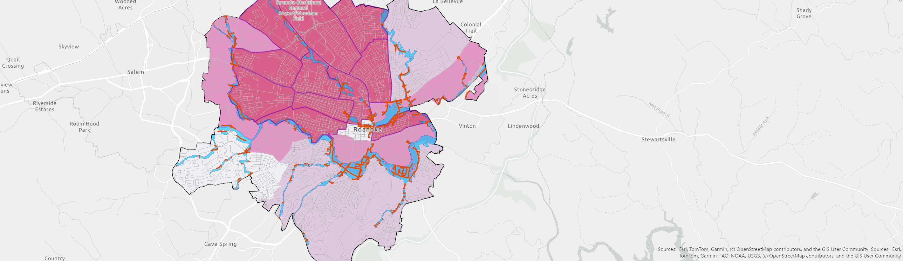

# Roanoke City Floodplain Exposure & Social Vulnerability Analysis

## Project Overview
This project examines the intersection of flood hazards,
transportation infrastructure, and social vulnerability
in Roanoke City, Virginia.

-Analyzed mapped floodplain areas,
road networks, and census tract vulnerability to 
identify areas of potential environmental exposure.

## Tools & Technologies
- ArcGIS Pro
- CDC/ATSDR Social Vulnerability Index (2022)
- City of Roanoke GIS datasets
- Spatial analysis and cartographic visualization

## Methodology
1. Obtained floodplain, road, and boundary datasets.
2. Clipped geographic data to Roanoke City.
3. Selected and dissolved relevant floodplain polygons.
4. Intersected road centerlines with floodplain areas.
5. Calculated exposed road-centerline lengths.
6. Evaluated census tract social vulnerability.
7. Created a thematic map displaying spatial patterns.

## Key Findings
- 41.30 miles of road centerlines intersected the
  mapped 1%-annual-chance floodplain.
- 11 census tracts with high social vulnerability
  had some floodplain overlap.

These findings illustrate how flood hazards,
transportation infrastructure, and social
vulnerability can coincide geographically.

## Final Cartography Map

## Project Files
- [Full Cartography Report](report/Cartography%20Project%20-%20Aidan%20Bennett.pdf)
- [ArcGIS Pro Project](project/cartography_project.aprx)

## Limitations
Analysis measures geographic overlap rather than
actual flood damage, road closures, or population impacts

The ArcGIS Pro project file may require the original
GIS datasets to open with all layers intact.
